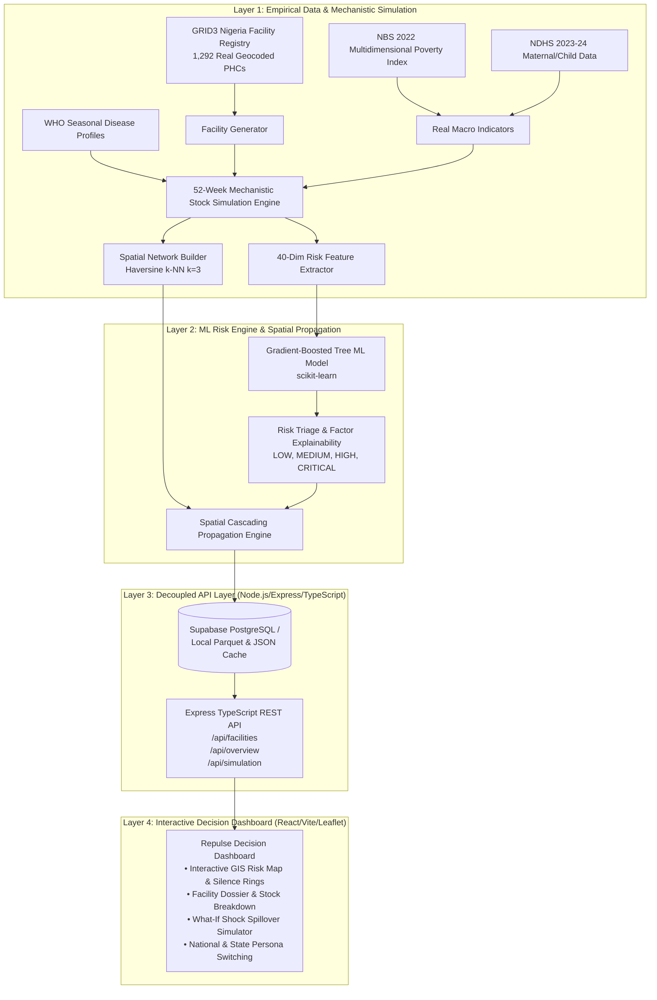

# 🏥 Repulse
### *Predictive Facility Risk Triage, Cascading Disruption Simulation & Early-Warning Platform for Nigeria's Primary Healthcare System*

[](https://www.python.org/)
[](https://www.typescriptlang.org/)
[](https://react.dev/)
[](https://vitejs.dev/)
[](https://expressjs.com/)
[](https://supabase.com/)
[](LICENSE)

---

## 📑 Table of Contents

- [Overview](#-overview)
- [Data Documentation in `data_layer/data_docs/`](#-data-documentation-in-data_layerdata_docs)
- [The Core Problem: Why Conventional Systems Fail](#-the-core-problem-why-conventional-systems-fail)
- [System Architecture](#️-system-architecture)
- [Data Sources & Public Health Calibration](#-data-sources--public-health-calibration)
- [Monitored Essential Commodities](#-monitored-essential-commodities)
- [Tech Stack](#-tech-stack)
- [Repository Directory Structure](#-repository-directory-structure)
- [Quickstart Guide](#-quickstart-guide)
  - [Prerequisites](#1-prerequisites)
  - [Step 1: Run the Data Pipeline](#2-step-1-run-the-data-pipeline-python)
  - [Step 2: Start the Backend API (Port 5000)](#3-step-2-start-the-backend-api-terminal-1)
  - [Step 3: Start the Frontend Dashboard (Port 3000)](#4-step-3-start-the-frontend-dashboard-terminal-2)
- [Key Dashboard Capabilities](#-key-dashboard-capabilities)
- [Analytical Validation & Findings](#-analytical-validation--findings)
- [Documentation Index](#-documentation-index)
- [Team & Acknowledgements](#-team--acknowledgements)
- [License](#-license)

---
## 📌 Overview

**Repulse** is an early-warning platform for Nigeria's Primary Healthcare Centres (PHCs). It predicts facility-level stockouts, staffing collapses and patient overflow *before* they become crises, and it treats a facility that stops reporting as a warning sign rather than missing data.

### The problem

PHCs are meant to be the first point of care for most Nigerians, but the system is under severe strain:

- **Few facilities work fully.** In 2016 the Health Minister said only about 20% of the country's roughly 30,000 PHCs were fully functional ([Blueprint](https://blueprint.ng/only-20-health-facilities-functional-minister/)). An NGO investigation found the same, and reported that even functioning centres struggled with staffing, supplies and infrastructure ([Oxford Business Group](https://oxfordbusinessgroup.com/improving-primary-care-local-clinics-are-a-promising-solution-to-gaps-in-coverage/)).
- **Medicines are often missing.** The 2025 National Health Facility Survey found essential drugs available at 36.2% of primary facilities, against 60.6% at secondary facilities. Katsina was lowest at 15.7% ([NAN](https://nannews.ng/survey-highlights-weaknesses-in-diagnosis-equipment-drugs-availability/)). The 2023 round found 34.3% ([TheCable](https://thecable.ng/nbs-only-34-essential-drugs-available-in-nigerias-primary-health-facilities)).
- **Key commodities stock out for long periods.** A survey of 1,858 facilities in 7 northern states found ACT stockout rates above 50% in every state, and rapid malaria tests out of stock at over half of facilities in 5 states ([Global Health: Science and Practice](https://www.ghspjournal.org/content/ghsp/12/3/e2200547.full.pdf)). In Katsina, one malaria stockout lasted 222 days ([IJPHS](https://ijphs.iaescore.com/index.php/IJPHS/article/view/18218)).
- **Basic infrastructure is missing.** Across PHCs in 16 states, 38% had no electricity and 39% relied on unsafe water ([NAN / Orodata](https://nannews.ng/97-of-phcs-in-16-states-fail-staffing-standard/)). BudgIT's 2025 survey found an average of 5.93 health workers per facility, with nearly three in four PHCs having no physician ([Guardian Nigeria](https://guardian.ng/featured/85-phcs-in-distress-without-doctors-despite-n55-4b-budget-in-4yrs/)).
- **Power failures threaten the cold chain.** In Nasarawa State, vaccine cold-chain performance was undermined by poor maintenance, thin training and no backup power, even though most facilities use solar ([IJCMPH](https://www.ijcmph.com/index.php/ijcmph/article/view/15599)).
- **The burden falls hardest where poverty is highest.** 63% of Nigerians are multidimensionally poor, rising to 72% in rural areas ([Vanguard](https://www.vanguardngr.com/2022/11/133m-nigerians-multidimensionally-poor-nbs/amp/)). Child outcomes track this: under-five mortality is 110 per 1,000 nationally ([FMINO](https://fmino.gov.ng/fg-launches-2024-ndhs-report-unveils-data-on-fertility-child-mortality-others/)), but Gombe (157) and Yobe (145) are far above it ([BusinessDay](https://businessday.ng/health/article/one-in-every-nine-children-die-before-age-five-report/)).

### The gap

Routine reporting through DHIS2 shows what facilities choose and manage to submit. A Gombe State study found DHIS2 can support monitoring, but that reporting completeness and data quality need sustained supervision and coordinated action ([PLOS ONE via PubMed](https://pubmed.ncbi.nlm.nih.gov/30682130/)). It records what has already happened and depends on busy staff to report. Nothing in it looks ahead, and nothing models what one facility's failure does to its neighbours.

When a PHC fails, patients move elsewhere. Roughly 60-90% of patients in Nigeria already bypass their local PHC, mainly because of provider shortages, missing equipment and irregular opening hours ([Journal of Global Health Reports](https://researchportal.beds.ac.uk/en/publications/a-qualitative-study-of-health-care-providers-perceptions-and-expe/)). The result is overcrowded secondary and tertiary hospitals ([BusinessDay](https://businessday.ng/health/article/nigerias-tertiary-health-facilities-pressure-dormant-phcs/)).

### What Repulse does

1. **Predicts facility risk.** A gradient-boosted model scores each facility from staffing, infrastructure, stock levels, seasonality and local poverty and health indicators, then explains the score factor by factor.
2. **Treats silence as a signal.** Our working hypothesis is that a facility with one nurse and no reliable power is more likely both to stock out and to miss reporting deadlines. Each consecutive silent week therefore raises its risk through a Markov decay model ($P(\text{Report}_t) = P_0 \times 0.72^k$). The decay rate is a modelling assumption, not an empirically measured value.
3. **Simulates cascading overflow.** A Haversine $k$-nearest-neighbour network lets planners apply a shock to one facility and see how demand redistributes to its neighbours. The spillover mechanics are a model assumption, informed by the patient-bypass evidence above.
4. **Surfaces hidden risk.** Every facility gets a Base Risk Score and an Adjusted Cascading Risk Score, so planners can find facilities that look stable but are one bad week from being overwhelmed.

### A note on data

Facility locations come from the real [GRID3 Nigeria](https://nigeria.grid3.org/) registry, and macro indicators are calibrated to NBS 2022 MPI and NDHS 2023-24 results. Weekly stock levels and reporting behaviour are **simulated** from public-health priors, because facility-level stock data is not openly available. The figures in the *Analytical Validation* section therefore describe the simulation's behaviour, not measured real-world outcomes. See [`data_layer/data_docs/DATA_AND_ASSUMPTIONS.md`](data_layer/data_docs/DATA_AND_ASSUMPTIONS.md) for every assumption.

---

## 📂 Data Documentation in `data_layer/data_docs/`

Comprehensive documentation for the data pipeline, empirical calibrations, and underlying assumptions is maintained inside [`data_layer/data_docs/`](data_layer/data_docs):

1. **[`data_layer/data_docs/DATA_AND_ASSUMPTIONS.md`](data_layer/data_docs/DATA_AND_ASSUMPTIONS.md)**:
   * Exhaustive mathematical, policy, and epidemiological justifications for every indicator.
   * Official National Bureau of Statistics (NBS) 2022 Multidimensional Poverty Index (MPI) benchmarks across all 6 geopolitical zones.
   * Detailed breakdown of the two regional seasons: South (bimodal rain) vs. North (unimodal rain & severe Harmattan dust peaks).
   * Markov compounding silence decay formulation ($P(\text{Report}_t) = P_0 \times 0.72^k$).

2. **[`data_layer/data_docs/DATA_ARCHITECTURE.md`](data_layer/data_docs/DATA_ARCHITECTURE.md)**:
   * End-to-end data pipeline flow from raw GRID3 CSV to columnar Parquet files and Supabase PostgreSQL.
   * Execution roles for each script (`run_pipeline.py`, `facility_generator.py`, `simulation_engine.py`, `network_builder.py`, `feature_extractor.py`, `risk_engine.py`).
   * Schema details for all generated Parquet files and 25,000-row chunked database batch loading.

---

## 💡 The Core Problem: Why Conventional Systems Fail

* **Conventional Systems (DHIS2 / LMIS)**:  
  Facility Faces Crisis → Staff Overwhelmed → Stops Submitting Reports → Treated as "No Data" → ❌ **Silent Failure**

* **Repulse Early-Warning Paradigm**:  
  Facility Faces Crisis → Stops Submitting Reports → Silence Decay Triggered → Spatial Overflow Simulated → 🚨 **Immediate Early Warning**

1. **Silence Compounds ("The Silent Crisis")**: A facility with one nurse and no solar inverter is both more likely to stock out of essential medicines and more likely to miss weekly reporting deadlines. In standard dashboards, non-reporting facilities fade away into blank rows. In Repulse, every consecutive week of silence compounds the risk score using a calibrated Markov decay model ($P(\text{Report}_t) = P_0 \times 0.72^k$).
2. **Cascading Disruption & Patient Spillover**: Facilities do not exist in geographic vacuums. When a primary clinic runs out of Artemether-Lumefantrine (ACTs) or pediatric Amoxicillin DT, sick patients travel to the next closest facility. That neighboring facility—already operating with minimal inventory buffers—is suddenly struck by an unexpected surge in demand. Repulse builds a spherical **Haversine $k$-Nearest Neighbors network** to model and simulate multi-hop cascading failures.
3. **Hidden Risk Detection**: A facility can appear fully stocked and stable on paper, yet sit in the epicenter of surrounding facility collapses. Repulse computes both an isolated **Base Risk Score** and an **Adjusted Cascading Risk Score**, highlighting facilities that are *"one bad week away from being overwhelmed."*

---

## 🏛️ System Architecture

Repulse is structured into four decoupled, production-grade layers:



---

## 🔬 Data Sources & Public Health Calibration

Repulse avoids synthetic arbitrariness by anchoring all simulations in authentic Nigerian public health registries and national surveys (see detailed breakdown in [`data_layer/data_docs/DATA_AND_ASSUMPTIONS.md`](data_layer/data_docs/DATA_AND_ASSUMPTIONS.md)):

| Dataset / Source | Origin & Authority | Application in Repulse |
| :--- | :--- | :--- |
| **Master Health Facility Registry** | [GRID3 Nigeria GeoPortal](https://nigeria.grid3.org/) | 1,292 authentic public health facilities with verified GPS coordinates, wards, and National Health Facility Registry (NHFR) codes across 24 LGAs. |
| **Multidimensional Poverty Index (MPI 2022)** | [National Bureau of Statistics (NBS)](https://nigerianstat.gov.ng) | Official Alkire-Foster MPI scores ($H \times A$) for all 6 geopolitical zones and focal states (0.026 in Lagos to 0.562 in Yobe; no artificial 0.90 scores). |
| **Demographic and Health Survey (NDHS 2023–24)** | [National Population Commission (NPC)](https://nationalpopulation.gov.ng) | State-level Full Immunization Coverage (FIC %), Antenatal Care (ANC 4+ visits), and Under-5 Mortality per 1,000 live births. |
| **Minimum Standards for PHC** | [NPHCDA / FMOH](http://ngfrepository.org.ng:8080/jspui/handle/123456789/3153) | Facility tier normalization: Comprehensive Health Centre (CHC), Primary Health Centre (PHC), Primary Health Clinic, and Health Post. |
| **Task-Shifting & Task-Sharing Policy** | Federal Ministry of Health (FMOH) | Realistic staffing models for Community Health Extension Workers (CHEWs), nurse-midwives, and medical officers. |
| **CCEOP Solar Direct Drive (SDD) Standards** | National Cold Chain Strategy | Infrastructure calibration for solar refrigeration, borehole water, and grid reliability. |

### Focal Cohort: 6 States Across All 6 Geopolitical Zones
- **South West**: **Lagos** (Urban commercial benchmark, MPI: `0.026`, Incidence $H$: `5.9%`)
- **South South**: **Bayelsa** (Riverine Niger Delta terrain, MPI: `0.186`, Incidence $H$: `40.6%`)
- **North Central**: **Plateau** (Central highland terrain, MPI: `0.259`, Incidence $H$: `55.6%`)
- **South East**: **Ebonyi** (Agrarian rurality, endemic cholera risks, MPI: `0.380`, Incidence $H$: `73.0%`)
- **North West**: **Sokoto** (Border Sahelian rurality, lowest immunization baselines, MPI: `0.536`, Incidence $H$: `87.9%`)
- **North East**: **Yobe** (Conflict recovery infrastructure, MPI: `0.562`, Incidence $H$: `89.5%`)

---

## 💊 Monitored Essential Commodities

The system tracks 8 vital medicines and vaccines under Nigeria's Integrated Management of Childhood Illness (IMCI) and maternal healthcare guidelines:

1. **Artemether-Lumefantrine (AL / ACT) 20/120mg**: First-line antimalarial. Surges 1.85x during rainy seasons.
2. **Amoxicillin 250mg Dispersible Tablets (DT)**: First-line pediatric pneumonia antibiotic. Surges 1.40x during the dusty Harmattan season.
3. **Oral Rehydration Salts (ORS) + Zinc Co-pack**: Pediatric diarrhea management. Spikes 1.60x during seasonal flash floods.
4. **Oxytocin Injection 10 IU/ml**: Critical maternal uterotonic for Postpartum Hemorrhage (PPH). Requires strict 2–8°C cold chain.
5. **Pentavalent Vaccine (DTP-HepB-Hib)**: Core routine infant immunization at 6, 10, and 14 weeks. 2–8°C cold chain required.
6. **Measles Vaccine**: Routine 9-month immunization. Dry season outbreaks surge demand by 1.50x.
7. **Malaria Rapid Diagnostic Test (mRDT)**: National "Test Before Treat" policy mandate.
8. **Clean Delivery Mama Kits**: Sterile childbirth delivery packs. Constant baseline demand.

---

## 💻 Tech Stack

### Data Layer & Machine Learning (`data_layer/`)
- **Language**: Python 3.10+
- **Data Engineering**: `pandas`, `numpy`, `pyarrow` (columnar Parquet storage)
- **Machine Learning**: `scikit-learn` (`GradientBoostingRegressor`), `scipy`
- **Network Graphing**: `networkx` (Spherical Haversine distance computations)
- **Database Loaders**: `psycopg2-binary`, `sqlalchemy` (PostgreSQL / Supabase batching)
- **Code Quality**: `ruff`
- **Detailed Documentation**: [`data_layer/data_docs/`](data_layer/data_docs)

### Backend API (`backend/`)
- **Runtime**: Node.js & TypeScript (`tsx`)
- **Framework**: Express 4.21
- **Database Client**: `@supabase/supabase-js`
- **Architecture**: Modular Services, Controllers, and Routes with auto-fallback to local files if Supabase is offline.

### Frontend Dashboard (`frontend/`)
- **Core**: React 18, TypeScript, Vite
- **Mapping & GIS**: Leaflet, `react-leaflet`
- **Data Visualizations**: Recharts
- **Icons & Styling**: Lucide-React, Pure Vanilla CSS (Electric Blue Clinical Design System with glassmorphism and micro-animations)

---

## 📂 Repository Directory Structure

```text
repulse/
├── .docs/
│   └── PHC_Pulse_Implementation_Guide.pdf  # Implementation guide & hackathon blueprint
├── backend/                                # Node.js / TypeScript REST API (Port 5000)
│   ├── src/
│   │   ├── config/supabase.ts              # Supabase database connection
│   │   ├── controllers/facilityController.ts
│   │   ├── routes/
│   │   │   ├── facilityRoutes.ts           # Facility query & detail endpoints
│   │   │   ├── overviewRoutes.ts           # Global statistics & analytics routes
│   │   │   └── simulationRoutes.ts         # Cascading shock simulator route
│   │   ├── services/
│   │   │   ├── cascadingEngine.ts          # Graph stress propagation algorithm
│   │   │   ├── dataLoader.ts               # Supabase fetcher with local fallback
│   │   │   └── riskEngine.ts               # Runtime risk scoring & factor breakdown
│   │   ├── types/index.ts                  # Shared TypeScript interfaces
│   │   └── server.ts                       # Express server entrypoint
│   ├── package.json
│   └── tsconfig.json
├── data_layer/                             # Python Data Pipeline & Risk Models
│   ├── data/
│   │   ├── models/risk_scoring_model.joblib
│   │   ├── processed/                      # Columnar Parquet & JSON datasets
│   │   └── raw/                            # Raw indicators & commodity catalog
│   ├── data_docs/                          # 📖 In-Depth Data Documentation Directory
│   │   ├── DATA_AND_ASSUMPTIONS.md         # Public health calibration & empirical sources
│   │   ├── DATA_ARCHITECTURE.md            # Pipeline architecture & execution guide
│   │   └── NIGERIA MULTIDIMENSIONAL POVERTY INDEX SURVEY RESULTS 2022 (1).pdf
│   ├── db/
│   │   ├── load_to_db.py                   # Programmatic database loader
│   │   ├── load_to_supabase.py             # Memory-efficient streaming loader (25k batches)
│   │   └── supabase_schema.sql             # Relational PostgreSQL DDL schema & indexes
│   ├── commodities.py                      # Essential medicine & vaccine catalog
│   ├── facility_generator.py               # GRID3 CSV processor & facility generator
│   ├── feature_extractor.py                # 40-feature risk matrix builder
│   ├── network_builder.py                  # Haversine k-NN proximity graph builder
│   ├── real_indicators.py                  # NBS 2022 MPI & NDHS indicator repository
│   ├── requirements.txt
│   ├── risk_engine.py                      # Gradient-boosted regressor & triage model
│   ├── run_pipeline.py                     # Master end-to-end data pipeline entrypoint
│   └── simulation_engine.py                # 52-week stock & reporting decay simulator
├── frontend/                               # React + Vite + Leaflet Web Application (Port 3000)
│   ├── src/
│   │   ├── components/
│   │   │   └── FacilityMap.tsx             # Interactive Leaflet GIS map with pulsing silence rings
│   │   ├── services/api.ts                 # Typed API client
│   │   ├── styles/index.css                # Clinical design system & styling
│   │   ├── types/index.ts                  # Frontend TypeScript definitions
│   │   ├── App.tsx                         # Core dashboard application
│   │   └── main.tsx
│   ├── index.html
│   ├── package.json
│   └── vite.config.ts
├── .env                                    # Root environment configuration
└── README.md                               # Project documentation
```

---

## ⚡ Quickstart Guide

To run Repulse, execute the backend API and frontend dev server side-by-side. The Vite frontend runs on port `3000` and automatically proxies all `/api/*` network requests to the Express backend running on port `5000`.

### 1. Prerequisites
- **Python 3.10+**
- **Node.js 18+** & **npm** (or **pnpm**)
- *(Optional)* Supabase PostgreSQL connection string (The backend automatically falls back to local precomputed data in `data_layer/data/processed` if no database credentials are supplied).

---

### 2. Step 1: Run the Data Pipeline (Python)

```bash
# 1. From workspace root, activate virtual environment
# Windows:
venv\Scripts\activate
# Linux/macOS:
source venv/bin/activate

# 2. Install dependencies (if not already installed)
pip install -r data_layer/requirements.txt

# 3. Execute the data pipeline
python data_layer/run_pipeline.py

# Optional Flags:
# python data_layer/run_pipeline.py --force     # Recompute all 537k records from scratch
# python data_layer/run_pipeline.py --skip-db   # Skip Supabase cloud database loading
```

---

### 3. Step 2: Start the Backend API (Terminal 1)

In your first terminal:

```bash
cd backend

# Install dependencies (if needed)
npm install
# or: pnpm install

# Start Express API server (runs on http://localhost:5000)
npm run dev
# or: pnpm dev
```

> **Note**: The backend initializes the dataset and begins listening at `http://localhost:5000`. Keep this terminal running!

---

### 4. Step 3: Start the Frontend Dashboard (Terminal 2)

In a second terminal:

```bash
cd frontend

# Install dependencies (if needed)
npm install
# or: pnpm install

# Launch Vite development server (runs on http://localhost:3000)
npm run dev
# or: pnpm dev
```

> **Access the App**: Open your browser to **`http://localhost:3000`**.  
> The Vite dev server forwards all `/api` calls directly to `http://localhost:5000`.

---

## 🚀 Key Dashboard Capabilities

### 1. Persona-Based Operational Views
- **Federal Ministry of Health (National Admin)**: High-altitude macro view across all 6 geopolitical zones, state risk comparisons, national stockout rates, and aggregated silence statistics.
- **State Primary Health Care Agency Admins**: Immediate drill-down into local state facilities (e.g., Lagos, Sokoto, Yobe, Bayelsa, Plateau, Ebonyi) with localized LGA rankings and urgent action items.

### 2. Interactive GIS Risk Map
- **Color-Coded Risk Triage**: Real-time visualization of facilities categorized into `LOW`, `MEDIUM`, `HIGH`, and `CRITICAL` risk tiers.
- **Compounding Silence Pulse Rings**: Distinct animated radar pulses highlight facilities suffering from reporting blackouts ($\ge 3$ consecutive weeks).
- **Proximity Network Overlay**: Visualizes spatial edges connecting neighboring health centres to reveal potential overflow vectors.

### 3. Detailed Facility Dossier & Explainability
- **Clinical Risk Factor Breakdown**: Clear, human-readable explanations behind every risk score (e.g., *"4-week reporting silence (+25 pts), no functional cold chain (+15 pts), severe ACT stockout in neighboring facility (+10 pts)"*).
- **Weekly Inventory Inspection**: Live status for all 8 monitored commodities, days of stock remaining, unmet demand, and cold-chain temperature breach alerts.

### 4. Interactive "What-If" Cascading Shock Simulator
- Health planners can select any health facility, dial in an artificial shock magnitude (e.g., $+35\%$ sudden disease surge or logistics cutoff), and trigger a multi-hop simulation.
- The simulator models how patients redirect along Great-Circle routes to the $k=3$ nearest neighboring clinics, calculating real-time added stress, new adjusted risk scores, and secondary facility collapses.

---

## 📊 Analytical Validation & Findings

During pipeline execution, analytical checks confirm core operational dynamics:

- **Silence is a Critical Warning Signal**: Facilities silent for 3 or more weeks exhibit an **actual stockout rate more than $2.5\times$ higher** than facilities reporting consistently.
- **Rural Vulnerability Gradient**: Rural facilities operate with an average of **$1.8$ staff members** (vs. $6.4$ in urban centers), only **$14.2\%$ solar cold-chain coverage**, and lower 12-week reporting completeness.
- **Network Cascades**: In dense rural clusters, a complete stockout at a single Comprehensive Health Centre transfers up to **$35\%$ of its patient load** to adjacent clinics, triggering secondary stockouts within 10 to 14 days.

---

## 📖 Documentation Index

| Document | Location | Description |
| :--- | :--- | :--- |
| **Data & Assumptions Guide** | [`data_layer/data_docs/DATA_AND_ASSUMPTIONS.md`](data_layer/data_docs/DATA_AND_ASSUMPTIONS.md) | Grounded public health evidence base, NBS 2022 MPI calibrations, seasonal profiles, and Markov decay formulas. |
| **Data Architecture & Pipeline** | [`data_layer/data_docs/DATA_ARCHITECTURE.md`](data_layer/data_docs/DATA_ARCHITECTURE.md) | Technical blueprint of datasets, Parquet columnar schemas, and Supabase database ingestion routines. |
| **Official NBS 2022 MPI Survey** | [`data_layer/data_docs/NIGERIA MULTIDIMENSIONAL POVERTY INDEX SURVEY RESULTS 2022 (1).pdf`](data_layer/data_docs/NIGERIA%20MULTIDIMENSIONAL%20POVERTY%20INDEX%20SURVEY%20RESULTS%202022%20(1).pdf) | Official survey publication from the National Bureau of Statistics (NBS). |
| **Implementation Guide** | [`.docs/PHC_Pulse_Implementation_Guide.pdf`](.docs/PHC_Pulse_Implementation_Guide.pdf) | Original architectural and hackathon implementation blueprint. |

---

## 👥 Team & Acknowledgements

### Project Team
* **Ayodele Rebecca** — Software Engineer
* **Ogechukwu Okoli** — Data Engineer

### Acknowledgements & Data Partners
Special thanks to:
* **GRID3 Nigeria** for open-access health facility geographic data.
* **National Bureau of Statistics (NBS)** for the 2022 Multidimensional Poverty Index dataset.
* **National Population Commission (NPC)** for the Nigeria Demographic and Health Survey.
* **National Primary Health Care Development Agency (NPHCDA)** for primary healthcare delivery benchmarks.

---

## 📄 License
This project is licensed under the MIT License - see the [LICENSE](LICENSE) file for details.
